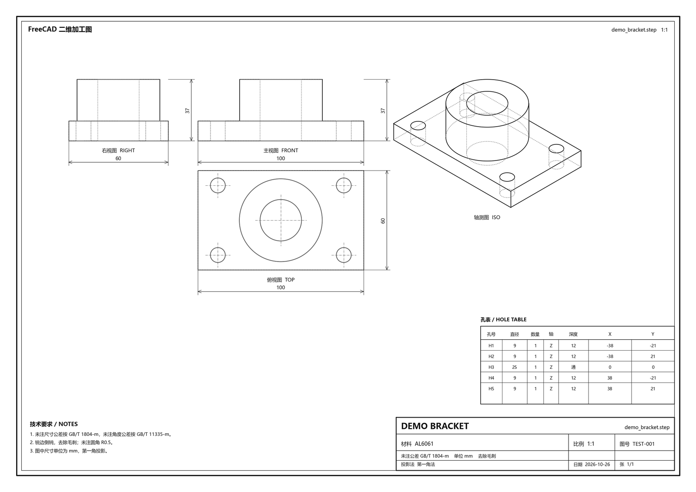
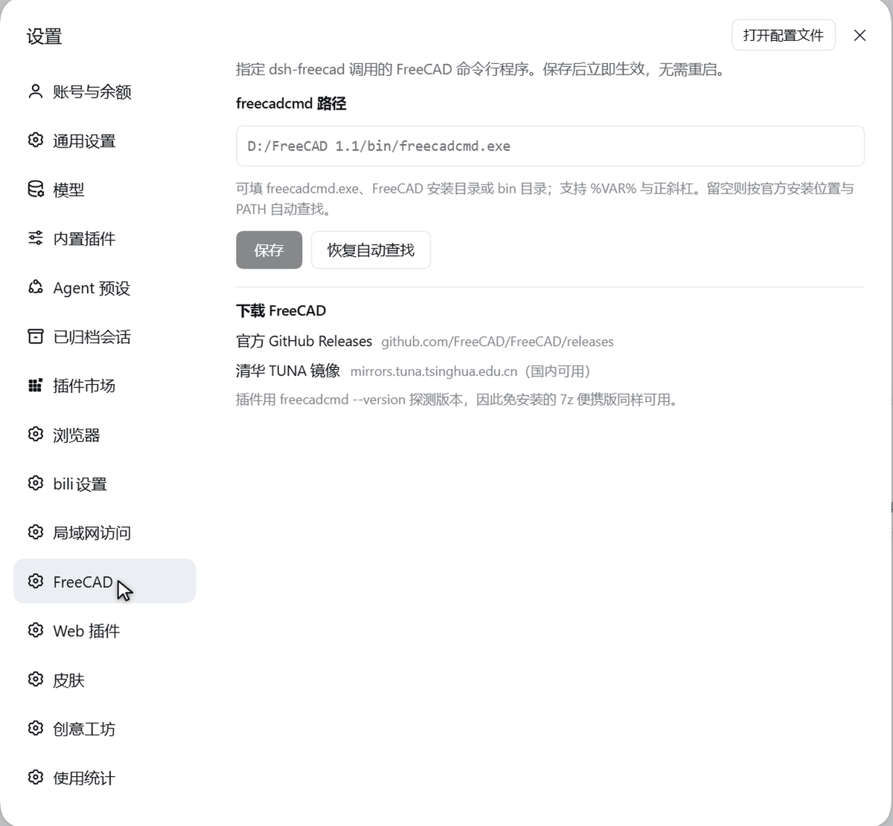

# dsh-freecad

English · [中文](README.md)

Let an AI agent read, edit and draw your local CAD files: **inspect STEP/STP, edit solids
geometrically, and produce a first-angle 2D drawing**. All geometry runs inside FreeCAD's own
process — nothing is uploaded, and DSH does not need a Python toolchain of its own.



*`examples/demo_bracket.step` rendered by `freecad_step_to_drawing` as an A3 sheet (SVG, DXF, PDF
and PNG in one call).*

## What it is — and what it is not

**It is** a thin bridge between what a language model says and the operations FreeCAD can execute.
You can ask "turn this part into a shop drawing", "drill an Ø8 through-hole here" or "fillet that
edge with R2" and the model calls the matching tool.

**It is not:**

- **A production drawing generator.** Sheets carry overall width/height plus a hole table; feature
  dimensions (boss diameters, step heights, per-view hole locations) must be added by hand, and
  there are no sections, detail views, GD&T or surface-finish symbols. **Do not send the output
  straight to a machine shop.** See [docs/limitations.md](docs/limitations.md).
- **A CAD kernel.** Everything is FreeCAD. If FreeCAD cannot open the file, neither can this.
- **A cloud service.** No network calls, no telemetry; models never leave the machine.

## Requirements

| Dependency | Requirement |
| --- | --- |
| OS | **Windows 10/11 (tested)**; Linux and macOS work only once `freecadcmd` is pointed at manually |
| FreeCAD | 1.0 or 1.1, with `freecadcmd` (both the installer and the portable build provide it) |
| DSH | A build with bundle support (the `dsh.bundle.patch` mechanism) |
| Node.js | 18+ (DSH's bundled runtime is enough) |

Verified combination: **Windows 11 + FreeCAD 1.1.4 (portable) + DSH Desktop**. Other combinations
are untested — reports welcome.

## Installation

The plugin is an ordinary DSH bundle. It is mounted at startup, so **restart DSH after installing**.

### A. From this repository (recommended)

```bash
git clone <this-repo> dsh-freecad
cd dsh-freecad
node scripts/install.mjs                       # ~/.dsh/profiles/desktop by default
node scripts/install.mjs --profile "C:\Users\me\.dsh\profiles\other"
```

The installer copies the package to `<profile>/plugins/dsh-freecad`, records a `file:` dependency in
`package.json`, appends the package to `dsh.profile.bundles`, adds an `insert` entry to
`cordis.patch.yml`, and runs `pnpm install` (falling back to a plain copy when pnpm is missing).
**Every modified file is backed up as `*.bak-<timestamp>` first.**

### B. As a local path dependency

```jsonc
// <profile>/package.json
{
  "dependencies": { "dsh-freecad": "file:./plugins/dsh-freecad" },
  "dsh": { "profile": { "bundles": [ /* … */, "dsh-freecad" ] } }
}
```

### C. From npm (once published)

```bash
cd ~/.dsh/profiles/desktop
pnpm add dsh-freecad            # or @scope/dsh-freecad
# then add "dsh-freecad" to dsh.profile.bundles in package.json
```

### After installing

**Restart DSH**, then ask the agent to run `freecad_status`:

```
FreeCADCmd: C:\Program Files\FreeCAD 1.1\bin\freecadcmd.exe
来源: default | 存在: true | worker: true
版本: FreeCAD 1.1.4
```

## Pointing at your FreeCAD

Open **DSH → Settings → FreeCAD** and paste the full path to `freecadcmd`:



A portable build, for example:

```
D:\Tools\FreeCAD_1.1.4-Windows-x86_64-py311\bin\freecadcmd.exe
```

The change applies to the next tool call — **no restart needed**, because the field is a volatile
config that re-applies the plugin configuration on save. The same page links to the official GitHub
releases and the TUNA mirror (fast inside China).

Resolution order: **settings page → profile config `config.freecadPath` → `FREECAD_CMD` →
`C:\Program Files\FreeCAD 1.1|1.0|FreeCAD\bin\freecadcmd.exe`**. The first two accept an executable
path, a `bin` directory, or an installation root.

## Tools

| Tool | Purpose |
| --- | --- |
| `freecad_status` | Reports the `freecadcmd` path, version and worker readiness. **Call this first when something is wrong.** |
| `freecad_inspect_step` | Reads STEP/STP/IGES/BREP: bounding box, volume, area, face/edge/vertex counts, object list, cylindrical-hole detection (diameter, axis, through/blind, depth, centre). `detail: true` returns faces and edges — use it to get the 1-based edge indices for fillets and chamfers. |
| `freecad_edit_step` | Translate/rotate/scale/mirror, drill through or blind holes, boolean with box/cylinder/sphere, fillet or chamfer by 1-based edge index; writes a new STEP (never overwrites the input unless asked) and optionally a FCStd. |
| `freecad_step_to_drawing` | HLR hidden-line removal → first-angle front/top/right/iso views, automatic sheet and scale, overall dimensions, hole centrelines, hole table, title block; exports SVG / DXF / PDF / PNG. |

All lengths are **mm**. Parameter details: [docs/tools.md](docs/tools.md).

## Quick start

```text
You: Read examples/demo_bracket.step and tell me how many holes it has and how big it is.
You: Turn it into an A3 shop drawing with an isometric view; output PNG and DXF.
You: Drill an Ø8 through-hole at the centre of the top face, chamfer C1, and save a copy.
```

Those are three tool calls; output lands next to the input (`<name>_drawing/`, `<name>_edited.step`).

## Known issues

**A portable FreeCAD fails with `Could not create directories. Failed with: Access is denied.`**
Since 0.2.0 this is handled for you: when `freecadcmd` is not under `Program Files`, the host points
`FREECAD_USER_HOME` / `FREECAD_USER_DATA` / `TMP` at the system temp directory. Set these yourself
when you want to keep FreeCAD preferences in a known place (your values win):

```
FREECAD_USER_HOME=D:\Tools\FreeCAD\home
FREECAD_USER_DATA=D:\Tools\FreeCAD\data
TMP=TEMP=D:\Tools\FreeCAD\temp
```

**`freecad_status` reports not found although FreeCAD is installed**
Only the standard `C:\Program Files\...` locations are searched. Use the settings page or set
`FREECAD_CMD`.

**The drawing has very few dimensions**
That is the current design: overall width/height plus a hole table. Ask the model to read the
geometry and add annotations in conversation, or extend the engine per
[docs/drawing-engine.md](docs/drawing-engine.md).

**Python changes take effect, JavaScript changes do not**
`dsh/*.py` is reloaded on every call. `index.js` and `lib/client.js` require a **DSH restart**.

More in [docs/troubleshooting.md](docs/troubleshooting.md).

## Documentation

| Document | Contents |
| --- | --- |
| [architecture.md](docs/architecture.md) | The three layers, the request/result protocol, why geometry lives in FreeCAD's process |
| [tools.md](docs/tools.md) | Every parameter of the four tools, including the sharp edges |
| [drawing-engine.md](docs/drawing-engine.md) | HLR projection, view layout, dimensions, hole table, title block |
| [troubleshooting.md](docs/troubleshooting.md) | Install, deploy, common errors |
| [development.md](docs/development.md) | Changing the code, manual acceptance checklist |
| [limitations.md](docs/limitations.md) | Known limitations and TODO — **read this before filing a bug** |

## Contributing

Issues and pull requests are welcome, especially "minimal STEP reproduction + screenshot".
Rules are in [CONTRIBUTING.md](CONTRIBUTING.md): one concern per PR, **the Chinese and English
READMEs change together**, and customer CAD files are never committed.

## License

[MIT](LICENSE) © 2026 蓝色大肥鱼 (dsh-freecad).

This plugin does not bundle or redistribute FreeCAD. It depends at run time on FreeCAD
(LGPL-2.1-or-later) and the Python environment it ships (Pillow, matplotlib); see [NOTICE](NOTICE).
